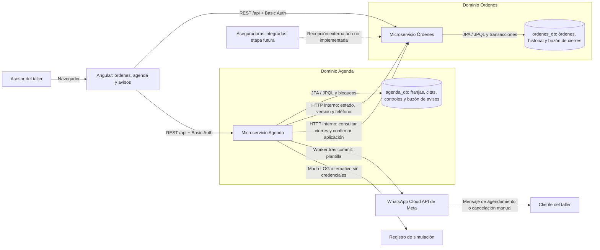

# Contexto y propiedad de datos

El asesor opera desde Angular. Los dominios se separan en dos microservicios Java; cada uno tiene una base y usuarios propios, aunque compartan una instancia física de MySQL. No hay consultas SQL entre dominios.

## Contratos y consistencia

- **Órdenes** posee cliente, vehículo y aseguradora como valores de la orden, su ciclo de estados y auditoría. Al cerrar guarda un evento en su propio buzón dentro de la misma transacción.
- **Agenda** posee franjas y capacidad por asesor, reservas, cancelaciones y notificaciones. Guarda solamente `ordenId` y la versión consultada como referencia externa.
- Agenda consulta el resumen de Órdenes antes de reservar. El contrato interno usa credenciales con rol SERVICIO y no está disponible para el frontend.
- Cada 15 segundos Agenda consulta hasta 20 cierres, cancela reservas anteriores a esa versión y confirma después del commit. Repetir un evento no duplica operaciones ni cancela nuevas reservas tras una reapertura. La consistencia entre servicios es eventual; si hay caída, se conservan los eventos.
- Agendar o cancelar manualmente escribe el aviso en la misma transacción de la cita. El trabajador llama a Meta fuera del bloqueo de cupos. El cierre automático no crea aviso de cancelación.
- La integración de grandes aseguradoras queda fuera; las restricciones de registro manual son configurables mediante `INTEGRATED_INSURERS`.

## Ejecución

| Entorno              | Angular                 | APIs Java                       | Persistencia             | Avisos                            |
| -------------------- | ----------------------- | ------------------------------- | ------------------------ | --------------------------------- |
| Docker Compose local | Nginx en localhost:4200 | localhost:8081 y localhost:8082 | MySQL local, dos bases   | LOG por defecto                   |
| Demostración pública | Vercel                  | Railway, dos servicios          | MySQL Railway, dos bases | WhatsApp con plantillas de prueba |

No hay Gateway, broker, registro de servicios ni un tercer microservicio de notificaciones. Nginx local sirve archivos de Angular; Vercel sirve el frontend en nube. Ambos usan las mismas APIs públicas de sus respectivos entornos.
